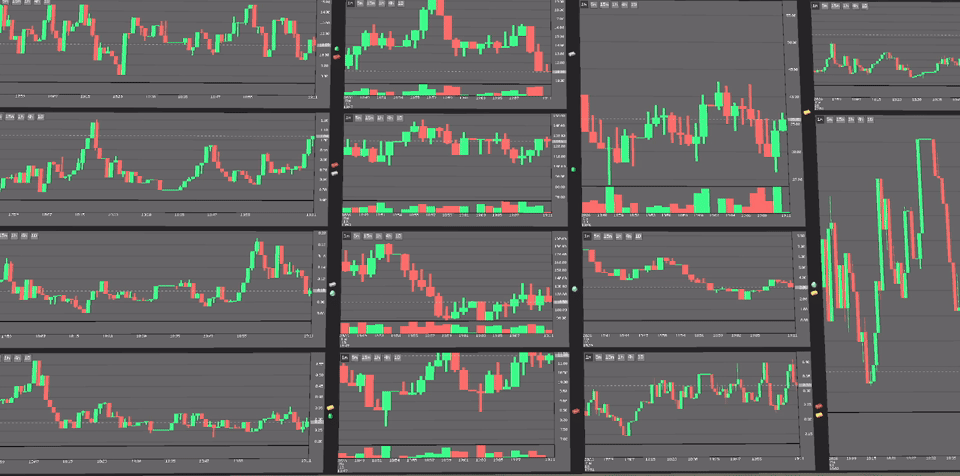

# StockMarket

    

StockMarket adds a market for any item, with a real order book: market and limit orders, matched between players. Markets stay alive without players: plugins add volume, price movement and a trading bot.

## Features

- A market for any item, with a real order book: [market and limit orders](https://kroia.github.io/BanksystemStockmarketDoku/stockmarket/trading/), matched between players.
- Swap one item for another in [Item / Item](https://kroia.github.io/BanksystemStockmarketDoku/stockmarket/pair-trading/) mode.
- [Candlestick charts](https://kroia.github.io/BanksystemStockmarketDoku/stockmarket/price-chart/) in the trading screen, on the [Stock Market Display](https://kroia.github.io/BanksystemStockmarketDoku/stockmarket/display-block/) and on an optional read-only [web page](https://kroia.github.io/BanksystemStockmarketDoku/admin/web-interface/).
- Markets stay alive without players: configurable [plugins](https://kroia.github.io/BanksystemStockmarketDoku/admin/stockmarket/plugins/) add volume, price movement and a trading bot.
- [Market news](https://kroia.github.io/BanksystemStockmarketDoku/stockmarket/newspaper/) that moves prices, read in a craftable Newspaper. Admins can [write their own events](https://kroia.github.io/BanksystemStockmarketDoku/admin/stockmarket/news/tutorial/) without touching code.
- [Company shares](https://kroia.github.io/BanksystemStockmarketDoku/stockmarket/company-shares/) trade like any item, and [villager prices](https://kroia.github.io/BanksystemStockmarketDoku/stockmarket/villager-trading/) follow the market.
- [Trading hours](https://kroia.github.io/BanksystemStockmarketDoku/admin/stockmarket/trading-hours/) for each market.
- [Multi-server markets](https://kroia.github.io/BanksystemStockmarketDoku/admin/multi-server/): connected servers trade on the same markets.
- [Placeholders](https://kroia.github.io/BanksystemStockmarketDoku/admin/placeholders/) for TAB and Placeholder API, a [Discord feed](https://kroia.github.io/BanksystemStockmarketDoku/admin/discord/) of trades and alerts and LuckPerms [permissions](https://kroia.github.io/BanksystemStockmarketDoku/admin/permissions/).
- An [API for mod authors](https://kroia.github.io/BanksystemStockmarketDoku/developers/) to read markets, place orders and write their own market plugins.

## Blocks and items

All recipes are on the [Blocks and recipes](https://kroia.github.io/BanksystemStockmarketDoku/stockmarket/blocks-and-recipes/) page.

| Block | What it does |
|---|---|
| **Stock Market Block** | Opens the trading screen. You don't craft it: right-click a BankSystem Terminal Block with Trading Software. |
| **Stock Market Display** | Shows a live price chart on a wall. |

| Item | What it is for |
|---|---|
| **Trading Software** | Turns a Terminal Block into a Stock Market Block. |
| **Newspaper** | Opens the market news. |

## Supported versions

StockMarket needs [BankSystem](https://www.curseforge.com/minecraft/mc-mods/banksystem) of the same version line (StockMarket `2.2.x` runs with BankSystem `2.2.x`), [Architectury API](https://www.curseforge.com/minecraft/mc-mods/architectury-api) and, on Fabric, [Fabric API](https://www.curseforge.com/minecraft/mc-mods/fabric-api). ModUtilities is inside the BankSystem jar, you don't have to install it. Details: [Installation](https://kroia.github.io/BanksystemStockmarketDoku/admin/install/).

Downloads: [CurseForge](https://www.curseforge.com/minecraft/mc-mods/stockmarket) · [Modrinth](https://modrinth.com/mod/kroia_stockmarket)

| Minecraft | Fabric | NeoForge |
|---|---|---|
| 26.3 | [][2.2.0-fabric-26.3] | [][2.2.0-neoforge-26.3] |
| 26.2 | [][2.2.0-fabric-26.2] | [][2.2.0-neoforge-26.2] |
| 26.1 | [][2.2.0-fabric-26.1] | [][2.2.0-neoforge-26.1] |
| 1.21.11 | [][2.2.0-fabric-1.21.11] | [][2.2.0-neoforge-1.21.11] |
| 1.21.10 | [][2.2.0-fabric-1.21.10] | [][2.2.0-neoforge-1.21.10] |
| 1.21.9 | [][2.2.0-fabric-1.21.9] | [][2.2.0-neoforge-1.21.9] |
| 1.21.8 | [][2.2.0-fabric-1.21.8] | [][2.2.0-neoforge-1.21.8] |
| 1.21.7 | [][2.2.0-fabric-1.21.7] | [][2.2.0-neoforge-1.21.7] |
| 1.21.6 | [][2.2.0-fabric-1.21.6] | [][2.2.0-neoforge-1.21.6] |
| 1.21.5 | [][2.2.0-fabric-1.21.5] | [][2.2.0-neoforge-1.21.5] |
| 1.21.4 | [][2.2.0-fabric-1.21.4] | [][2.2.0-neoforge-1.21.4] |
| 1.21.3 | [][2.2.0-fabric-1.21.3] | [][2.2.0-neoforge-1.21.3] |
| 1.21.2 | [][2.2.0-fabric-1.21.2] | [][2.2.0-neoforge-1.21.2] |
| 1.21.1 | [][2.2.0-fabric-1.21.1] | [][2.2.0-neoforge-1.21.1] |

Release notes for every version: [changelog/](changelog/)

<!-- Links to CurseForge -->
[2.2.0-neoforge-1.21.1]:https://www.curseforge.com/minecraft/mc-mods/stockmarket/files/9781895
[2.2.0-fabric-1.21.1]:https://www.curseforge.com/minecraft/mc-mods/stockmarket/files/9781893
[2.2.0-neoforge-1.21.2]:https://www.curseforge.com/minecraft/mc-mods/stockmarket/files/9781898
[2.2.0-fabric-1.21.2]:https://www.curseforge.com/minecraft/mc-mods/stockmarket/files/9781896
[2.2.0-neoforge-1.21.3]:https://www.curseforge.com/minecraft/mc-mods/stockmarket/files/9781901
[2.2.0-fabric-1.21.3]:https://www.curseforge.com/minecraft/mc-mods/stockmarket/files/9781900
[2.2.0-neoforge-1.21.4]:https://www.curseforge.com/minecraft/mc-mods/stockmarket/files/9781906
[2.2.0-fabric-1.21.4]:https://www.curseforge.com/minecraft/mc-mods/stockmarket/files/9781904
[2.2.0-neoforge-1.21.5]:https://www.curseforge.com/minecraft/mc-mods/stockmarket/files/9781909
[2.2.0-fabric-1.21.5]:https://www.curseforge.com/minecraft/mc-mods/stockmarket/files/9781908
[2.2.0-neoforge-1.21.6]:https://www.curseforge.com/minecraft/mc-mods/stockmarket/files/9781913
[2.2.0-fabric-1.21.6]:https://www.curseforge.com/minecraft/mc-mods/stockmarket/files/9781912
[2.2.0-neoforge-1.21.7]:https://www.curseforge.com/minecraft/mc-mods/stockmarket/files/9781918
[2.2.0-fabric-1.21.7]:https://www.curseforge.com/minecraft/mc-mods/stockmarket/files/9781916
[2.2.0-neoforge-1.21.8]:https://www.curseforge.com/minecraft/mc-mods/stockmarket/files/9781920
[2.2.0-fabric-1.21.8]:https://www.curseforge.com/minecraft/mc-mods/stockmarket/files/9781919
[2.2.0-neoforge-1.21.9]:https://www.curseforge.com/minecraft/mc-mods/stockmarket/files/9781922
[2.2.0-fabric-1.21.9]:https://www.curseforge.com/minecraft/mc-mods/stockmarket/files/9781921
[2.2.0-neoforge-1.21.10]:https://www.curseforge.com/minecraft/mc-mods/stockmarket/files/9781925
[2.2.0-fabric-1.21.10]:https://www.curseforge.com/minecraft/mc-mods/stockmarket/files/9781924
[2.2.0-neoforge-1.21.11]:https://www.curseforge.com/minecraft/mc-mods/stockmarket/files/9781927
[2.2.0-fabric-1.21.11]:https://www.curseforge.com/minecraft/mc-mods/stockmarket/files/9781926
[2.2.0-neoforge-26.1]:https://www.curseforge.com/minecraft/mc-mods/stockmarket/files/9781929
[2.2.0-fabric-26.1]:https://www.curseforge.com/minecraft/mc-mods/stockmarket/files/9781928
[2.2.0-neoforge-26.2]:https://www.curseforge.com/minecraft/mc-mods/stockmarket/files/9781932
[2.2.0-fabric-26.2]:https://www.curseforge.com/minecraft/mc-mods/stockmarket/files/9781930
[2.2.0-neoforge-26.3]:https://www.curseforge.com/minecraft/mc-mods/stockmarket/files/9781935
[2.2.0-fabric-26.3]:https://www.curseforge.com/minecraft/mc-mods/stockmarket/files/9781934
