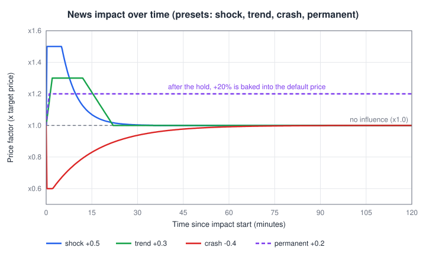
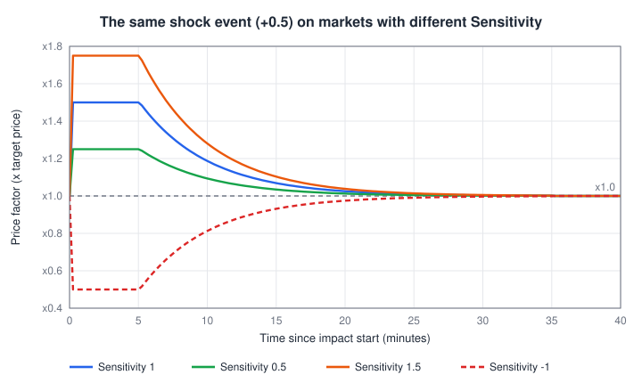

# NewsPlugin

The NewsPlugin publishes **news events** defined in JSON files and moves the prices of the affected markets while an event runs: a sudden shock, a slow trend, a crash, or a permanent shift. Players read the headlines in the newspaper item.

This page covers the plugin's **settings**. How events are written, the newspaper, the management window and the admin commands are described in the [News Event System](../../news-system/overview.md) documentation.

**How it moves prices:** the plugin does not trade. After all plugins have run their update, it **multiplies the target price** of every affected market:

```
factor of one event = 1 + influence(t) x weightFactor x Sensitivity
combined factor     = product of the factors of all active events on the market, limited to [0.1, 10]
new target price    = target price x combined factor
```

- `influence(t)` is the event's current influence: `peakFactor` shaped over time by the ramp-up, hold and reversal phases (or by the steps of a sequence event). `0.5` means +50 %.
- `weightFactor` comes from the event's market list (how strongly this item is affected by this event).
- `Sensitivity` is the per-market setting below.

**When to use it:** whenever you want story-driven price movement on top of the normal random walk. It is optional -- the market works without it.

**Interaction with other plugins:**

- It multiplies the target produced by the [VolatilityPlugin](volatility-plugin.md). The [TargetPriceBot](target-price-bot.md) then trades the real price toward the shifted target -- so how fast a news event shows up on the chart depends on the bot's gains.
- Because the multiplication happens in a separate stage after every plugin's update, its **position in the plugin list does not matter**.
- **Permanent events** multiply the market's **default price** when they end. The VolatilityPlugin's equilibrium, floor and ceiling are all relative to the default price, so they move with it.

## The Impact Over Time

Most events use one of three preset shapes (values can be overridden per event, see [impact](../../news-system/configuration.md#impact)):

| Preset | Ramp-up | Hold | Reversal |
|---|---|---|---|
| shock | 5 s | 5 min | exponential, time constant 5 min (gone after 30 min) |
| trend | 2 min | 10 min | linear over 10 min |
| crash | 10 s | 2 min | exponential, time constant 15 min (gone after 90 min) |

<p align="center">
  
</p>

Example: a diamond market with a target price of 160 and a shock event with `peakFactor 0.5`, `weightFactor 1` and Sensitivity 1. At the peak the target becomes 160 x 1.5 = **240**; 5 minutes after the hold ends (one time constant) the factor is 1 + 0.5 x 0.37 = 1.18, so the target is about **189**. If the market also has a crash event at -0.4 running, the factors multiply: 1.5 x 0.6 = 0.9.

A permanent event with +0.2 on the same market changes the default price from 160 to **192** when its hold phase ends. With the default Min/Max Price Multipliers of the VolatilityPlugin the equilibrium range moves from 8-3,200 to 9.6-3,840.

## Settings Overview

Open the plugin's window with **Open Plugin** in its entry on the [Plugin Management Screen](../management.md). The per-market editor sits on the right side of the window, the scheduler values on the [Scheduler tab](../../news-system/overview.md#scheduler-tab).

**Per-market settings** (select a market, then **Apply** for this market or **Apply to all** for every subscribed market after a confirmation dialog):

| Setting (UI name) | Default | Allowed values | What it controls |
|---|---|---|---|
| News enabled | on | on / off | Whether this market takes part in news at all |
| Sensitivity | `1.0` | any number (negative inverts) | How strongly news moves this market |

**Plugin-wide scheduler values** (override the `scheduler` block of the JSON files; **Apply** sends the edited values, **Reset to file** removes all overrides):

| Setting (UI name) | File default | Allowed values | What it controls |
|---|---|---|---|
| Min seconds between events | `900` (15 min) | > 0 and <= max | Shortest pause between two random events |
| Max seconds between events | `3600` (60 min) | >= min | Longest pause between two random events |
| Max active events (global) | `3` | >= 1 | How many events may run at the same time on the whole server |
| Max active events (per market) | `1` | >= 1 | How many events may affect one market at the same time |

Overrides persist across news reloads until they are reset. The same values can be set with `/stockmarket news scheduler set|reset` (see [Admin Commands](../../news-system/configuration.md#admin-commands)).

## Settings in Detail

### News enabled

When off, the market is excluded from news completely: no event can fire because of this market, and events that are already running stop affecting its price immediately. An event whose matched markets are all news-disabled (or not subscribed) never fires.

Use it for markets whose price must stay predictable -- a currency item, quest rewards -- without having to unsubscribe the market from the plugin.

### Sensitivity

Scales every news effect on this market, including the permanent shift of permanent events.

<p align="center">
  
</p>

| Sensitivity | Shock +0.5 at its peak | Crash -0.4 at its peak |
|---|---|---|
| 0 | x1.0 (no effect, but the market can still be picked) | x1.0 |
| 0.5 | x1.25 | x0.8 |
| 1 (default) | x1.5 | x0.6 |
| 2 | x2.0 | x0.2 |
| 3 | x2.5 | x0.1 (limit; 1 - 1.2 would be negative) |
| -1 | x0.5 (inverted) | x1.4 (inverted) |

**Tuning advice:**

- Lower Sensitivity (`0.3`-`0.7`) for staple items that should react to news only mildly.
- Raise it (`1.5`-`2`) for speculative items. Remember that crashes get much deeper: above about 2.5 a `-0.4` crash already hits the lower limit of x0.1.
- Use `0` (not News enabled = off) if a market should stay *eligible* -- events matching only this market can still fire and publish headlines -- but its price must not move.
- Negative values turn good news into bad news for this market. Prefer a negative `weightFactor` in the event file if only one event should work in reverse.

### Min / Max seconds between events

The pause before the next random event is picked uniformly between these two values. With the defaults the average pause is (900 + 3600) / 2 = 2,250 s, so about **1.6 random events per hour** -- if an eligible event exists. If nothing can fire when the time comes (all events on cooldown, caps reached), the scheduler waits a full new interval. Manually triggered and chained events do not use these slots.

Halve both values for a busy news feed on servers with active traders; double them if news should feel rare and important.

### Max active events (global / per market)

Caps on how many events may run at the same time. A market already at its per-market cap is skipped by new events, and if the global cap is reached no new random event starts. Chained follow-up events bypass these caps. With per market `1`, factors never stack on one market from random events alone; raising it allows combined moves such as 1.5 x 1.3 = 1.95.

## Generic Settings

These controls exist for every plugin and sit in the plugin entry of the [Plugin Management Screen](../management.md):

| Setting | Effect for this plugin |
|---|---|
| Enabled | When disabled, news stops affecting prices and all timers (event phases, cooldowns, scheduler) pause. Re-enabling continues where they stopped. |
| Auto-subscribe | Newly created markets are subscribed automatically (markets created with *Ignore Plugin Autosubscribe* are skipped). |
| Logger | Writes the plugin's log messages (loading, scheduling, publishing) to the server log. |
| Market subscriptions | Only subscribed markets can be affected by events. |
| Position in the list | No effect -- news is applied after every plugin's update. |
