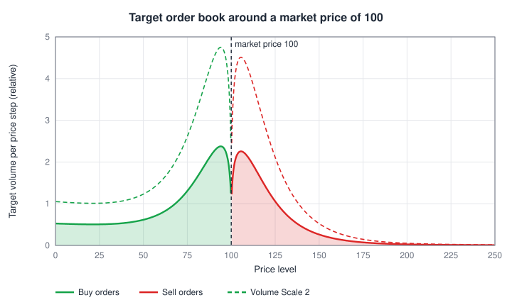
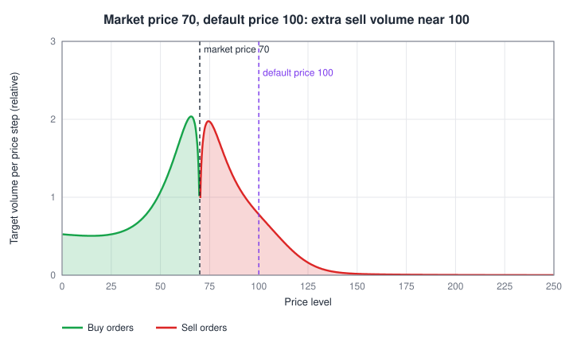
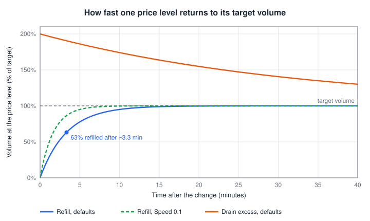

# Order Book Volume Distribution Plugin

*Registered as **DefaultOrderbookVolumeDistributionPlugin**.*

This plugin fills the order book with **virtual liquidity**: buy orders below the current price and sell orders above it. This is the volume players (and the [TargetPriceBot](target-price-bot.md)) trade against. Its depth decides how far the price moves when someone buys or sells a given amount.

The plugin computes a **target volume** for every price level around the current price and lets the real virtual volume drift toward that target over time. When players eat into the book, the consumed volume grows back gradually; when the price moves, the book reshapes around the new price.

**When to use it:** on every market that should be tradable without other players on the opposite side. Without it, a market order only fills against player limit orders and the order book looks empty.

**Interaction with other plugins:**

- The [TargetPriceBot](target-price-bot.md) moves the price by trading against this volume. It sizes its orders from the depth, so more depth does not slow the bot down -- but it does slow down **players**: they need more items to move the price.
- Net player flow for the [NetFlowPlugin](net-flow-plugin.md) is counted per item, independent of the depth. Its Book Depth Cap reads the default depth of this plugin.
- The item's **Abundance** sets the depth (see below): the book is sized so that a reference order of `max(64, 64 x Abundance)` items moves the price by about the same percentage on every market. The market's **Max order size** setting does not change the depth.
- Only works on markets whose virtual order book is enabled.

## Settings Overview

All settings are **per market**. Select a market icon in the plugin entry of the [Plugin Management Screen](../management.md), edit the fields and use one of the buttons:

- **Apply** -- send the values for the selected market. The volume then drifts to the new target over time.
- **Apply to all** -- send the values to every market subscribed to this plugin (after a confirmation dialog). Never resets the volume.
- **Reset Volume** -- apply the values for the selected market **and** immediately replace the market's virtual volume with the target distribution, skipping the gradual drift.

| Setting (UI name) | Default | Allowed values | What it controls |
|---|---|---|---|
| Volume Scale | `1` | number >= 0 | Overall depth of the book relative to the item's Abundance (1 = a reference order of `max(64, 64 x Abundance)` items moves the price about 0.36 %) |
| Speed | `0.05` | number >= 0 | Master speed of the drift toward the target; multiplies both rates |
| Accumulation Rate | `0.1` | number >= 0 | How fast missing volume is refilled |
| Decumulation Rate | `0.01` | number >= 0 | How fast excess volume is removed |
| Round Level Scale | `1` | number >= 0 | Extra volume at round prices (100, 200, 250, 300, 500, 1000, ...) as a multiple of the depth near the current price; 0 = off |
| Round Level Width | `0.03` | 0.005 - 0.5 | Width of a round-price cluster in log price (0.03 = about +-3 % around the level) |
| Round Level Range | `1.1` | 0.05 - 5 | How far from the current price round-price clusters stay visible (log-price distance at which a cluster drops to 37 %) |

The text fields accept only non-negative numbers.

## The Shape of the Book

For each price level the target volume is:

```
target volume = shape(price level) x depth scale x default price / current price
depth scale   = Volume Scale x max(250 x reference order x price step / default price, 0.1)
reference order = max(64, 64 x Abundance)
```

The depth is defined per **percent of price**, not per price step. With Volume Scale `1` the sell volume within 1 % above the default price holds about 3.5 reference orders, so a buy of one reference order moves the price about 0.36 % on every market, whatever the item costs. The factor `default price / current price` keeps this when the price moves away from the default: at half the default price there are twice as many price steps per percent, each with twice the volume.

- The **reference order** is the default max order size of the Abundance, `max(64, 64 x Abundance)` (for example 3,200 for Abundance 50). It equals the market's max order size as long as that is left at its default; a custom max order size (or 0 = unlimited) does not change the book.
- **Expensive items** get at least 0.1 items per price step (times Volume Scale), so a netherite block market never has a book so thin that single items jump the price. On such markets one reference order moves the price less than 0.36 %.
- **Cheap items** (price below about 1) have few price steps per percent, for example dirt at 0.1 moves in 10 % steps. Their book is deep per step: one reference order only uses a small part of the first step.
- Changing a market's **default price** rebuilds its book at the new depth right away (like **Reset Volume**). A changed **Abundance** changes the depth too; the book then drifts to it at the configured speed.

The shape is the sum of four parts, all measured relative to the current market price:

| Part | Where | What it does |
|---|---|---|
| Core | both sides | Almost nothing right at the price (a spread of at least 0.5 %), rising quickly to a peak about 5-10 % away, then fading out over roughly 15-50 % |
| Value cluster | around the **default price** | Extra volume within about +-15 % of the market's default price -- traders defend the "fair" price |
| Background | both sides | Thin liquidity at every price, fading slowly |
| Demand boost | buy side only | Buy interest grows the further the price is below the current price, so there is always some support underneath |

<p align="center">
  
</p>

Notice the asymmetry: sell volume above the price fades out beyond about +50 %, while buy volume below the price never disappears. Selling therefore meets more resistance than buying: the further the price falls, the more buy support it runs into, while strong buying can push the price up quickly once it has cleared the nearby sell volume.

When the market price has moved away from the default price, the value cluster adds a visible bump of extra liquidity near the default price. In this example the price was pushed down to 70; buyers who want to push it back above 100 must first get through the extra sell volume around 100:

<p align="center">
  
</p>

When the price moves, price levels that change side (for example from buy to sell) are emptied immediately and refilled with the opposite order type at the configured speed. After a fast price move, the levels the move swept through are empty and refill gradually (time constant `1 / (Accumulation Rate x Speed)`, about 200 s at default settings), so the next trade in the opposite direction can briefly spike the price.

### Round-price clusters

Real traders like round numbers, so the book adds extra volume around round prices: every price of the form `1, 2, 2.5, 3 or 5 x 10^n` (..., 10, 20, 25, 30, 50, 100, 200, ...). The added volume at a level is

```
Round Level Scale x (mean depth within +-1 % of the current price) x weight x exp(-distance / Round Level Range)
```

spread over a bell curve of width Round Level Width around the level. `distance` is `|ln(level / current price)|`; the weight is 1 for `1 x 10^n`, 0.8 for `5`, 0.6 for `2` and 0.5 for `2.5` and `3`. The clusters are added on top of the normal shape, so they also show far from the price: on a market at 160, the sell cluster at 1,000 holds about 19 % of the depth near the price and 2,000 about 6 %. Levels too weak to matter (below 3 % of full weight) are skipped, which leaves about 10-20 levels on any market.

A market whose price sits on a round level (dirt at 0.1) gets about twice the depth on that price step, so the same net player flow moves its equilibrium price somewhat less.

## Settings in Detail

### Volume Scale

Multiplies the depth of the whole book without changing its shape (dashed curves in the first chart). It is relative to the item's Abundance: at `1` a reference order of `max(64, 64 x Abundance)` items moves the price about 0.36 % on every market (cheap items move in whole price steps, see above). A higher Abundance gives a proportionally deeper book; the market's max order size does not.

**What it means for players:** the price impact of a trade is roughly inversely proportional to the depth. With Volume Scale `2` a player needs about twice as many items to push the price by the same percentage; with `0.5` half as many.

**Tuning advice:**

- If a single player can crash or pump a market with a few max orders, raise Volume Scale for that market or lower its max order size.
- If trades feel like they have no effect at all, lower it.
- Changes reach the market on its next update. Use **Reset Volume** to see the new depth immediately; otherwise it fills in over a few minutes.

### Speed, Accumulation Rate and Decumulation Rate

Each second, every price level moves part of the way toward its target:

```
change per second = (target - current volume) x rate x Speed
rate = Accumulation Rate   if the level holds less than its target (refill)
       Decumulation Rate   if the level holds more than its target (drain)
```

This is an exponential approach. The **time constant** `1 / (rate x Speed)` seconds is the time to cover 63 % of the way; after three time constants 95 % is done.

| Case | Defaults | Time constant | 95 % done after |
|---|---|---|---|
| Refill (Accumulation Rate x Speed) | 0.1 x 0.05 = 0.005 / s | 200 s (~3.3 min) | ~10 min |
| Drain (Decumulation Rate x Speed) | 0.01 x 0.05 = 0.0005 / s | 2,000 s (~33 min) | ~1.7 h |

<p align="center">
  
</p>

- **Speed** scales both directions at once. Doubling it halves both time constants (green dashed curve).
- **Accumulation Rate** controls how quickly liquidity comes back after players or the bot consumed it. Fast refill = deep, forgiving market where a big sale is absorbed and the book recovers quickly. Slow refill = after a large trade the book stays thin for a while, so follow-up trades move the price more.
- **Decumulation Rate** controls how quickly surplus volume disappears, for example after you lowered Volume Scale. It is deliberately slower than the refill so the book does not suddenly vanish.

**Tuning advice:**

- Keep `rate x Speed` well below 1. Values above 1 per second can overshoot the target after a server lag.
- Speed `0` freezes the book: consumed volume never comes back (only a Reset Volume refills it).
- For a market where players should be able to "drain" liquidity and feel the scarcity, lower Accumulation Rate (e.g. `0.02` gives a refill time constant of about 17 minutes).

## Generic Settings

These controls exist for every plugin and sit in the plugin entry of the [Plugin Management Screen](../management.md):

| Setting | Effect for this plugin |
|---|---|
| Enabled | When disabled, the book is no longer reshaped or refilled; existing virtual volume stays as it is. Settings and subscriptions are kept. |
| Auto-subscribe | Newly created markets are subscribed automatically (markets created with *Ignore Plugin Autosubscribe* are skipped). |
| Logger | Writes the plugin's log messages to the server log. |
| Market subscriptions | Subscribing a market resets its virtual volume to the target distribution. Only subscribed markets get virtual liquidity from this plugin. |
| Position in the list | Run it after the price-driving plugins (default: last). See [How Plugins Work Together](../overview.md#how-plugins-work-together). |
