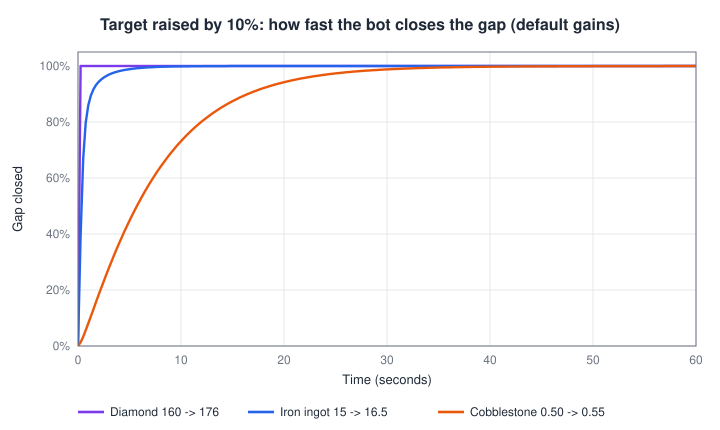
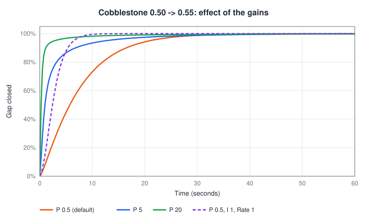

# TargetPriceBot

The TargetPriceBot is the market maker that **moves the real price toward the target price**. The target is set by the [VolatilityPlugin](volatility-plugin.md) and adjusted by the [NewsPlugin](news-plugin.md); the bot reads it and places market orders against the virtual order book until the price gets there.

Every 5 server ticks (about 4 times per second) the bot does this for each subscribed market:

1. **Gap** = target price - current price, in currency units. The bot uses the target committed in the previous update, which already includes any news effect.
2. A **PID controller** turns the gap into an output between -1 and +1 (see the settings below).
3. The output is the **fraction of the way to the target** the bot trades in this step. The bot measures how many items of virtual order book volume lie between the current price and the target and places a market order for that fraction: buy if the target is above, sell if it is below. An output of 1 consumes all volume up to the target and moves the price there at once; 0.2 closes roughly a fifth of the remaining gap.

The bot sizes its orders from the virtual order book depth only and never trades past the target in a single step. Player limit orders in the way still get filled by its market orders.

**When to use it:** on every market that has a VolatilityPlugin (or any other plugin that sets a target price). Without the bot, the target price is calculated but nothing moves the real price toward it.

**Interaction with other plugins:**

- Needs a target from the [VolatilityPlugin](volatility-plugin.md) on the same market.
- Trades against the virtual volume created by the [order book volume distribution plugin](orderbook-volume-distribution.md). With more depth the bot simply places bigger orders, so Volume Scale does not change how fast the bot reaches the target.
- After a player trade the bot holds the price near the level the player pushed it to and lets it return to the target over the Reversion time. It holds it at most at the edge of the [NetFlowPlugin](net-flow-plugin.md)'s default price band, 5 % to 3 times the equilibrium price: a player who dumps or pumps the price beyond that band sees the bot bring it back to the band edge, and the slow return starts from there.
- Only works on markets whose virtual order book is enabled.

## Settings Overview

The bot has its own settings screen: click **Open Plugin** in its entry on the [Plugin Management Screen](../management.md). The screen shows a candlestick chart with the target price as an orange line, a market list (bottom left) and the **PID Settings** (right). Select a market, edit the values and click **Apply** (this market) or **Apply to all** (every subscribed market, after a confirmation dialog).

| Setting (UI name) | Default | Allowed values | What it controls |
|---|---|---|---|
| P Gain | `0.5` | any number | Reaction to the current gap |
| I Gain | `0.1` | any number | Build-up when a gap persists |
| D Gain | `0` | any number | Reaction to how fast the gap changes |
| Rate | `0.1` | number >= 0 | Maximum contribution of the I part (not a speed or update rate) |

The fields accept negative numbers, but negative gains make the bot trade away from the target. Use only values >= 0.

## How the PID Output Is Calculated

```
I part   = I part + gap x seconds since last step x I Gain, then limited to [-Rate, +Rate]
raw      = P Gain x gap + I part + D Gain x (change of the gap per second)
output   = average of the previous output and raw   (smoothing)
fraction = output limited to [-1, +1]
```

**The gap is measured in currency, not in percent.** The same gains therefore behave very differently on cheap and expensive items. With the default P Gain of 0.5:

| Item | Price | Gap for a 10 % target move | P Gain x gap | Result |
|---|---|---|---|---|
| Diamond | 160 | 16 | 8, limited to 1 | Gap closed in the first step |
| Iron Ingot | 15 | 1.5 | 0.75 | ~85 % of the gap closed after 1 second |
| Cobblestone | 0.5 | 0.05 | 0.025 | Mainly the I part works: ~45 % after 5 s, ~99 % after 30 s |

<p align="center">
  
</p>

The chart is idealized: it assumes nothing else trades and the target stays still. In a running market the target keeps moving with the random walk and players trade too, so the price trails the target by about the response time shown.

## Settings in Detail

### P Gain

How hard the bot reacts to the gap right now. `P Gain x gap = 1` means "close the whole gap in this step".

A useful rule of thumb: the target usually moves a few percent away from the price (about 4 % with the default Volatility Scale of 0.3). To make the bot close about half of such a gap within a second and 85-95 % within five seconds, pick

```
P Gain ~= 6 / price
```

| Item | Price | Suggested P Gain |
|---|---|---|
| Diamond | 160 | 0.04 (the default 0.5 closes almost every gap in one step) |
| Iron Ingot | 15 | 0.4 (default fits) |
| Cobblestone | 0.5 | 12 |

**What a high or low value feels like for players:**

- **High P Gain** (price glued to the target): when a player sells a large stack, the price drops, and within a second the bot buys it back up to the target. Player trades leave almost no visible trace on the chart; only the flow-driven equilibrium of the [NetFlowPlugin](net-flow-plugin.md) moves the price long-term.
- **Low P Gain**: player trades push the price away and it drifts back over seconds to minutes. Players see the effect of their trades, and the market feels more player-driven.

### I Gain

Accumulates the gap over time and closes small, persistent gaps that P Gain alone is too weak for. It is the reason cheap items still reach their target with the default P Gain. Too high a value makes the price overshoot the target and swing around it.

### Rate

The limit of the I part (anti-windup). However long a gap persists, the I part never adds more than `Rate` to the output -- with the default `0.1` the I part alone closes at most about 10 % of the gap per step. P Gain alone shrinks its own effect as the gap gets smaller, so a small remainder is always closed by the I part. Raise Rate together with I Gain if a cheap market trails its target for too long; lower it if the price overshoots after long one-sided moves.

<p align="center">
  
</p>

### D Gain

Reacts to how fast the gap changes and damps overshoot. The output is already smoothed, so the default of `0` works for almost every market. Avoid large values: when a news event moves the target suddenly, D Gain produces a short spike of very aggressive trading.

### Tuning checklist

1. Start from the defaults and watch the orange target line in the bot's screen.
2. Price lags far behind the target (common on items below about 2): raise **P Gain** (rule of thumb above).
3. Price overshoots and oscillates around the target: lower **I Gain** or **Rate**, then P Gain.
4. Players complain that their trades have no effect: lower **P Gain** so the price returns more slowly.

## Generic Settings

These controls exist for every plugin and sit in the plugin entry of the [Plugin Management Screen](../management.md):

| Setting | Effect for this plugin |
|---|---|
| Enabled | When disabled, the bot stops trading and the price only moves through player trades. Settings and subscriptions are kept. |
| Auto-subscribe | Newly created markets are subscribed automatically (markets created with *Ignore Plugin Autosubscribe* are skipped). |
| Logger | Writes a line for every order the bot places (amount, PID output, volume to target) to the server log. Very noisy -- use it only for debugging. |
| Market subscriptions | The bot only trades on subscribed markets. |
| Position in the list | Keep it after the VolatilityPlugin (default order). See [How Plugins Work Together](../overview.md#how-plugins-work-together). |
