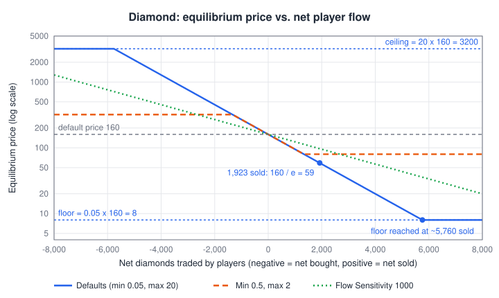
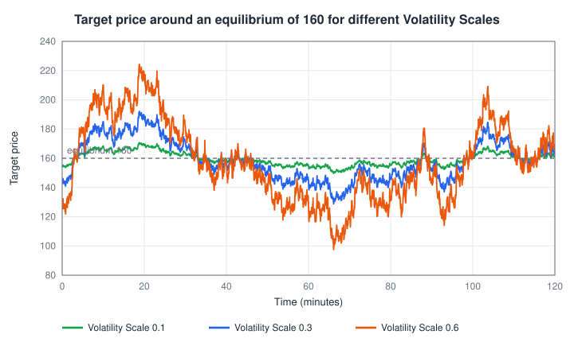

# VolatilityPlugin

The VolatilityPlugin decides **where a market's price wants to be**. Every server tick it writes a *target price* for each subscribed market. It does not trade by itself -- the [TargetPriceBot](target-price-bot.md) places the orders that move the real price toward that target.

The target price has two parts:

1. **Equilibrium price** -- the anchor. It starts at the market's default price and moves permanently when players sell more of the item than they buy (price goes down) or buy more than they sell (price goes up).
2. **Random walk** -- a slow, organic wobble around the equilibrium so the chart never looks flat.

```
target price = equilibrium price x (1 + random walk value x Volatility Scale)
```

**When to use it:** on every market that should move by itself. Without it (or without a TargetPriceBot on the same market), prices only change when players trade.

**Interaction with other plugins:**

- The [TargetPriceBot](target-price-bot.md) steers the real price toward the target set here. Subscribe both plugins to the same markets.
- The [NewsPlugin](news-plugin.md) multiplies this target during news events, after all plugins have run. A permanent news event changes the market's *default price*, which shifts the equilibrium with it.
- The plugin only works on markets whose virtual order book is enabled. Markets with the virtual order book switched off are skipped.

## Settings Overview

All settings are **per market**. Select a market icon in the plugin entry of the [Plugin Management Screen](../management.md), edit the fields, then click **Apply** (this market only) or **Apply to all** (every market subscribed to this plugin, after a confirmation dialog). Hover over a field to see its tooltip.

| Setting (UI name) | Default | Allowed values | What it controls |
|---|---|---|---|
| Volatility Scale | `0.3` | number >= 0 | Size of the random wobble around the equilibrium |
| Player Flow Influence | on | on / off | Whether player trading moves the equilibrium at all |
| Flow Sensitivity | `500` | number; <= 0 turns flow influence off | How many items it takes to move the equilibrium |
| Min Price Multiplier | `0.05` | strictly between 0 and 1 | Lowest equilibrium, as a fraction of the default price |
| Max Price Multiplier | `20` | greater than 1 | Highest equilibrium, as a multiple of the default price |

The text fields accept only non-negative numbers.

## How the Equilibrium Price Is Calculated

Every market counts its **net player flow**: items players sold into the market minus items they bought from it. Selling 100 diamonds and buying back 30 leaves a net flow of +70 diamonds. Trades of bots and the virtual order book are not counted -- only real player fills.

From that number the plugin computes:

```
capacity    = Flow Sensitivity x natural abundance / (1 + Volatility Scale)
equilibrium = default price x e^(-net flow / capacity)
              ...limited to [Min Price Multiplier x default price, Max Price Multiplier x default price]
```

- **Natural abundance** is the market's *Abundance* value (set in the market settings or the preset). Common items have high abundance, rare items low abundance, so common items need far more trading to move.
- **Capacity** is the number of items players must net-sell to drop the equilibrium to about **37 %** of the default price (a factor of e = 2.72). Net-buying the same amount raises it **2.72x**.
- The curve is exponential, so small flows have proportional effects: net-selling 10 % of the capacity lowers the equilibrium by about 10 %. The price approaches zero but never reaches it.
- A higher Volatility Scale makes the capacity slightly smaller, so very volatile markets react a bit faster to player flow.

### Worked examples (all defaults: Flow Sensitivity 500, Volatility Scale 0.3, Min 0.05, Max 20)

Values from the built-in presets:

| Item | Default price | Abundance | Capacity (items) | Floor / reached after net-selling | Ceiling / reached after net-buying |
|---|---|---|---|---|---|
| Diamond | 160 | 5 | 500 x 5 / 1.3 = **1,923** | 8 / ~5,760 | 3,200 / ~5,760 |
| Iron Ingot | 15 | 30 | 500 x 30 / 1.3 = **11,538** | 0.75 / ~34,600 | 300 / ~34,600 |
| Cobblestone | 0.5 | 200 | 500 x 200 / 1.3 = **76,923** | 0.025 / ~230,000 | 10 / ~230,000 |

Some concrete moves:

- Players net-sell **200 diamonds**: 160 x e^(-200/1923) = **144** (about -10 %).
- Players net-sell **1,000 diamonds**: 160 x e^(-0.52) = **95**.
- Players net-buy **1,000 diamonds**: 160 x e^(+0.52) = **269**.
- Players net-sell **5,000 iron ingots**: 15 x e^(-0.43) = **9.73**.
- Players net-sell **20,000 cobblestone** (about six double chests): 0.5 x e^(-0.26) = **0.39**.

<p align="center">
  
</p>

On the log-scale chart above the equilibrium is a straight line between two flat limits. **Flow Sensitivity** changes the slope (green: twice as many items needed), **Min/Max Price Multiplier** move the flat floor and ceiling (orange: a tight 0.5 to 2 band).

## Settings in Detail

### Volatility Scale

Strength of the random wobble, relative to the equilibrium price. `0` turns the wobble off; the target then sits exactly on the equilibrium.

The random walk is a sum of five slow, mean-reverting random walks. It advances every 0.1 to 1.1 seconds; its fastest part changes over seconds, its slowest part over about half an hour. Measured over long runs, the random value is usually within +-0.15, 90 % of the time within +-0.39 and 99 % of the time within +-0.61. Multiplied by the Volatility Scale this gives:

| Volatility Scale | Typical deviation | 90 % of the time within | Practically never beyond |
|---|---|---|---|
| 0.1 | +-1.5 % | +-4 % | +-9 % |
| 0.3 (default) | +-4.4 % | +-12 % | +-26 % |
| 0.6 | +-9 % | +-23 % | +-53 % |
| 1.0 | +-15 % | +-39 % | +-88 % |

<p align="center">
  
</p>

**Tuning advice:**

- `0.1`-`0.2` for staples that should feel stable (food, building blocks).
- `0.3` (default) for a lively market.
- `0.5`-`0.8` for speculative items. Keep it below about `1`: the target is cut off at 0, so very large values can drive the target price to zero in a deep swing.
- The deviation is a percentage, so the same value behaves the same on cheap and expensive items.

### Player Flow Influence

Turns the flow-driven equilibrium on or off. When off, the equilibrium is always exactly the default price, and player trading only moves the price temporarily (the TargetPriceBot pulls it back). Net flow is still counted while it is off, so switching it on later applies all flow collected so far.

Turn it off for markets that should always return to a fixed price, for example a currency-like item or an item whose price you control manually.

### Flow Sensitivity

How "heavy" the market is. It sets the capacity together with the item's abundance (see the formula above). Doubling Flow Sensitivity doubles the number of items needed for the same price move. A value of `0` or below disables the flow influence, the same as unchecking Player Flow Influence.

**Tuning advice:**

- Estimate how many items your players can realistically farm per week, then pick a value so that this amount moves the price by the amount you want. For a -10 % move you need about `0.105 x capacity` items; for -50 % about `0.69 x capacity`.
- Example: players can dump about 500 diamonds per week and you want that to cost them about 20 % of the price. `-ln(0.8) = 0.223`, so capacity should be `500 / 0.223 = 2,240`. With abundance 5 and Volatility Scale 0.3: Flow Sensitivity = `2,240 x 1.3 / 5 = 582`.
- Small servers usually want a lower value (prices react to few players), large servers a higher one.
- To give a single item a different sensitivity, you can also change its Abundance instead -- but Abundance also changes the order book depth of the [volume distribution plugin](orderbook-volume-distribution.md).

### Min Price Multiplier and Max Price Multiplier

The floor and ceiling for the **equilibrium**, as a fraction or multiple of the default price. With the defaults a diamond's equilibrium stays between 160 x 0.05 = 8 and 160 x 20 = 3,200.

- Min must be strictly between 0 and 1, Max must be greater than 1. Any other value is silently replaced by the default (0.05 or 20) when the price is calculated.
- Items needed to reach the floor: `capacity x ln(1 / Min)`. Items needed to reach the ceiling: `capacity x ln(Max)`. With defaults both are about `3 x capacity`.

Important to know:

- **They bound the equilibrium, not the final price.** The random walk still swings around the floor or ceiling (with Volatility Scale 0.3 a diamond at the floor of 8 still wobbles between roughly 7 and 9), news events multiply the target on top, and players can still trade the real price beyond the target for a while.
- **Flow stops counting at the limits.** Once the equilibrium reaches the floor or ceiling, the plugin holds the Net Flow counter at that point, so extra flow is not stored. If players net-sell 10,000 diamonds, the counter stops at about +5,760 (the floor of 8); the moment players buy diamonds back, the equilibrium starts rising again -- there is no dead zone to trade back first. If you narrow the band or change the Flow Sensitivity, Volatility Scale or Abundance later, the counter is pulled into the new band on the next update. While Player Flow Influence is off, or no Volatility Plugin is subscribed to the market, the counter is not limited. To re-anchor a market at its default price, press **Reset** next to **Net Flow** in the market's settings on the Management Screen.

**Tuning advice:**

- Tight band (e.g. `0.5` / `2`) for items whose price should stay recognisable, such as a currency item or key progression items.
- Wide band (defaults) for a free market where heavily farmed items can become nearly worthless.
- Setting Min to `1/Max` (e.g. `0.1` and `10`) makes crash and boom equally far away in item terms.

## Generic Settings

These controls exist for every plugin and sit in the plugin entry of the [Plugin Management Screen](../management.md):

| Setting | Effect for this plugin |
|---|---|
| Enabled | When disabled, the target price is no longer updated. Settings and subscriptions are kept. |
| Auto-subscribe | Newly created markets are subscribed automatically (markets created with *Ignore Plugin Autosubscribe* are skipped). |
| Logger | Writes the plugin's log messages to the server log. |
| Market subscriptions | Only subscribed markets get a target price from this plugin. |
| Position in the list | Run this plugin **before** the TargetPriceBot (default order). See [How Plugins Work Together](../overview.md#how-plugins-work-together). |
