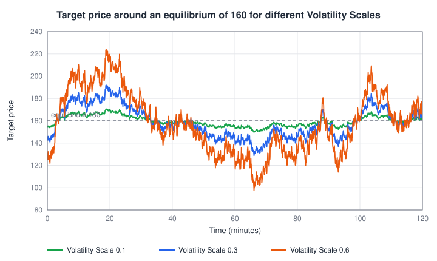

# VolatilityPlugin

The VolatilityPlugin adds **a slow, organic random walk** to a market's price so the chart never looks flat. Every server tick it writes a *target price* for each subscribed market. It does not trade by itself -- the [TargetPriceBot](target-price-bot.md) places the orders that move the real price toward that target.

```
target price = equilibrium price x (1 + random walk value x Volatility Scale)
```

The **equilibrium price** comes from the [NetFlowPlugin](net-flow-plugin.md), which moves it with net player buying and selling. Without a NetFlowPlugin on the market, the equilibrium is the market's default price. All flow settings (Player Flow Influence, Flow Sensitivity, Min/Max Price Multiplier, Permanent Impact, Long-term Anchor) are on the [NetFlowPlugin page](net-flow-plugin.md).

**When to use it:** on every market that should move by itself. Without it (or without a TargetPriceBot on the same market), prices only change when players trade.

**Interaction with other plugins:**

- The [NetFlowPlugin](net-flow-plugin.md) runs before it and publishes the equilibrium the walk is centred on.
- The [TargetPriceBot](target-price-bot.md) steers the real price toward the target set here. Subscribe both plugins to the same markets.
- The [NewsPlugin](news-plugin.md) multiplies this target during news events, after all plugins have run.
- The plugin only works on markets whose virtual order book is enabled. Markets with the virtual order book switched off are skipped.

## Settings

The setting is **per market**. Select a market icon in the plugin entry of the [Plugin Management Screen](../management.md), edit the field, then click **Apply** (this market only) or **Apply to all** (every market subscribed to this plugin, after a confirmation dialog).

| Setting (UI name) | Default | Allowed values | What it controls |
|---|---|---|---|
| Volatility Scale | `0.3` | number >= 0 | Size of the random wobble around the equilibrium |

## Volatility Scale

Strength of the random wobble, relative to the equilibrium price. `0` turns the wobble off; the target then sits exactly on the equilibrium.

The random walk is a sum of four mean-reverting parts with different speeds: one changes over minutes, one over about an hour, one over about 8 hours and one over 2 to 3 days. Most of the movement sits in the slowest part, so the price drifts in up and down trends that can last days, while the change within one hour stays small. The walk follows real time, so it looks the same however often it is updated. The random value is usually within +-0.32, 90 % of the time within +-0.77 and 99 % of the time within +-1.2. Multiplied by the Volatility Scale this gives:

| Volatility Scale | Typical deviation | 90 % of the time within | Practically never beyond | Typical change within one hour |
|---|---|---|---|---|
| 0.1 | +-3 % | +-8 % | +-14 % | +-1 % |
| 0.3 (default) | +-10 % | +-23 % | +-42 % | +-2 % |
| 0.6 | +-19 % | +-46 % | +-85 % | +-5 % |

<p align="center">
  
</p>

**Tuning advice:**

- `0.1`-`0.2` for staples that should feel stable (food, building blocks).
- `0.3` (default) for a lively market.
- `0.4`-`0.5` for speculative items. Keep it below about `0.6`: the target is cut off at 0, so larger values can drive the target price to zero in a deep swing.
- The deviation is a percentage, so the same value behaves the same on cheap and expensive items.

## Generic Settings

These controls exist for every plugin and sit in the plugin entry of the [Plugin Management Screen](../management.md):

| Setting | Effect for this plugin |
|---|---|
| Enabled | When disabled, the random walk is no longer added; the target is the NetFlowPlugin equilibrium (if subscribed). Settings and subscriptions are kept. |
| Auto-subscribe | Newly created markets are subscribed automatically (markets created with *Ignore Plugin Autosubscribe* are skipped). |
| Logger | Writes the plugin's log messages to the server log. |
| Market subscriptions | Only subscribed markets get a target price from this plugin. |
| Position in the list | Run this plugin **after** the NetFlowPlugin and **before** the TargetPriceBot (default order). See [How Plugins Work Together](../overview.md#how-plugins-work-together). |
